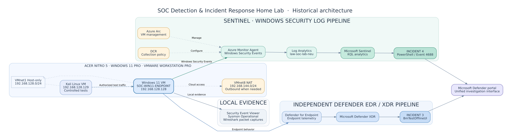

# SOC Detection & Incident Response Home Lab

**Windows endpoint monitoring · Microsoft Sentinel SIEM · Microsoft Defender for Endpoint / XDR · KQL · Incident investigation**

> **Portfolio status:** Historical, authorized home-lab exercises. This repository is a **pre-publication draft** with two QA-reviewed investigation case studies; it is not a production SOC system. Azure free credit expired and the Sentinel subscription was subsequently disabled. Current Microsoft Defender licensing and cloud telemetry have not been reverified.

## Overview

I built a small virtual SOC lab to practice generating, detecting, investigating, and documenting Windows security events. The project used a Windows 11 Enterprise Evaluation VM as the monitored endpoint and a Kali Linux VM for **authorized** testing inside VMware Workstation Pro. It developed across endpoint security, local logs, process/network telemetry, Microsoft Sentinel analytics, Defender XDR investigation, and evidence-based incident response.

The goal was to **prove what happened and explain why**, rather than merely install security tools. Two independently investigated, benign test cases demonstrate the SIEM and EDR/XDR workflows.

## Architecture



*Diagram source:* [Mermaid](architecture/architecture.mmd) (editable) · [Graphviz DOT](architecture/architecture.dot) (editable) · [PNG](architecture/architecture.png). The diagram depicts the historically implemented lab paths, **not** a currently operational cloud subscription.

**Physical management host:** Acer Nitro 5, Windows 11 Pro, VMware Workstation Pro. The host was **not an attack target**.

| Component | Role | Verified context |
| --- | --- | --- |
| Windows 11 Enterprise Evaluation VM | Monitored endpoint; local Security logs, Sysmon, Wireshark, Defender for Endpoint | `SOC-WIN11-ENDPOINT` / `DESKTOP-DC26UU9`, Host-only `192.168.128.128` |
| Kali Linux VM | Authorized testing and connectivity checks | Host-only `192.168.128.129` |
| VMnet1 (Host-only) | Windows–Kali private lab network; no direct bridged link to the home LAN | `192.168.128.0/24` |
| VMnet8 (NAT) | Controlled Windows outbound access for updates and Microsoft cloud services | `192.168.144.0/24` |
| Local evidence | Event Viewer, Sysmon events 1/3/5, Wireshark protocol captures | Collected/inspected on Windows VM |
| Sentinel SIEM | Windows Security events → AMA/DCR → Log Analytics → Sentinel KQL/analytics | Workspace `law-soc-lab-neu` |
| Defender EDR/XDR | Defender for Endpoint endpoint signals → Defender XDR alert/incident | Separate from Sentinel's `SecurityEvent` collection route |

**Important architecture distinctions:**

- **Azure Arc** onboarded/managed the non-Azure Windows VM; **Azure Monitor Agent (AMA)** collected and sent the Windows Security events. The **Data Collection Rule (DCR)** configured which events to collect; DCR is a policy, not a network hop.
- **Microsoft Sentinel** used the Log Analytics `SecurityEvent` table for the reviewed Windows authentication and process-creation evidence. Collection of **Sysmon events into Sentinel was not independently verified**; Sysmon and Wireshark observations in this repository are **local evidence**.
- **Defender for Endpoint / Defender XDR** supplied endpoint behavior, process stories, alerts and endpoint response tools through a **separate EDR path**. The Microsoft Defender portal displayed both services in a common interface; this did not merge the data pipelines.
- Host-only networking isolated intentional testing from the home LAN. VMnet8 NAT allowed VM-initiated outbound and return traffic when used; no unsolicited external inbound port forwarding was documented.

## Investigations

| Case study | What was investigated | Key result |
| --- | --- | --- |
| **[01 — Sentinel PowerShell detection](investigations/01-sentinel-powershell-detection/README.md)** | Windows Security Event `4688`, missing source audit policy, AMA/DCR ingestion, a scheduled KQL rule, Incident **4**, and the **34 → 12 → 1** event-correlation sequence | One Low-severity alert and Sentinel Incident 4; authorized security-test verdict, no incident-driven containment |
| **[02 — Defender XDR behavior-monitoring detection](investigations/02-defender-xdr-behavior-monitoring/README.md)** | Controlled `BmTestOfflineUI` PowerShell test, blocked alert, Incident **3**, `userinit.exe → explorer.exe → powershell.exe` context, alert triage and closure | Alert resolved after expected-activity classification in historical records; incident **Resolved / 0 active alerts**, but incident classification stayed **Unclassified** |

The [first report](investigations/01-sentinel-powershell-detection/README.md) centers on **SIEM detection engineering and investigation**. The [second report](investigations/02-defender-xdr-behavior-monitoring/README.md) centers on **EDR alert triage, process evidence and documented analyst disposition**. They represent two distinct authorized exercises, not two views of one incident.

For a quick employer-facing overview, see the [one-page recruiter summary](docs/recruiter-summary.md).

## Skills demonstrated

- Windows security-log analysis (`4624`, `4625`, `4688`) and source-side auditing of process creation.
- Sysmon event inspection and correlation of process starts, network connections and termination using Process GUIDs.
- Packet-level DNS/TCP/TLS inspection with Wireshark and correlation to the initiating process.
- VMware host-only/NAT network configuration, constrained lab scope, baseline snapshots and troubleshooting.
- Azure Arc onboarding, AMA/DCR data collection, Log Analytics and Microsoft Sentinel KQL analytics.
- Defender for Endpoint onboarding, behavior-monitoring validation, alert story/process-tree triage and endpoint response-capability exercises.
- Analyst reasoning: distinguish observed evidence from inference, benign testing from attacks, and alert-level from incident-level states.

## Selected troubleshooting lessons

1. **Verify telemetry at the source first.** The first PowerShell detection test produced no `4688` because Windows Process Creation auditing was disabled; enabling the audit policy restored source visibility.
2. **Confirm data arrives before building detections.** Another authentication investigation recovered an AMA expired-token issue and backlog before event `4625` was visible in `SecurityEvent`.
3. **A valid detection does not prove malicious intent.** Both exercises were intentionally generated and warranted non-disruptive analyst closure rather than unnecessary containment.
4. **Distinguish current UI state from a later result.** The source screenshots include pre-save rule/classification dialogs, but separate historical records and saved incident/alert views support the stated later outcomes.

## Repository contents

```text
SOC-Detection-and-Incident-Response-Home-Lab/
├── README.md                        # You are here
├── architecture/
│   ├── architecture.svg             # Viewable diagram
│   ├── architecture.png             # Raster version
│   ├── architecture.mmd             # Editable Mermaid source
│   ├── architecture.dot             # Editable Graphviz source
│   └── README.md                    # Flow boundaries and legend
├── investigations/
│   ├── 01-sentinel-powershell-detection/
│   │   ├── README.md
│   │   ├── evidence/                # Four selected, cropped screenshots
│   │   ├── EVIDENCE_MANIFEST.md
│   │   └── QA_STATUS.md
│   └── 02-defender-xdr-behavior-monitoring/
│       ├── README.md
│       ├── evidence/                # Five primary and one optional KQL image
│       ├── queries/                 # Original historical AlertInfo KQL
│       ├── EVIDENCE_MANIFEST.md
│       └── QA_STATUS.md
└── docs/
    ├── scope-and-evidence-limits.md
    ├── skills-matrix.md
    ├── recruiter-summary.md
    └── release-checklist.md
```

## Evidence, privacy and reproducibility

The screenshots are historical original-source crops. Both case studies include evidence manifests with screenshot provenance and **SHA-256 hashes for the original files and packaged crops**. Some retained lab-only identifiers (the VM hostname, local account, and workspace name) are intentionally visible for correlation; **a final public-disclosure decision is still pending**. Authentication secrets, raw investigation ZIP files, and unnecessary network identifiers were not included in this draft.

This repository does not offer a one-click deployable SOC environment. Commands and KQL are preserved **as historically used** or clearly labeled reconstructed examples. Historical seven-day queries should not be interpreted as current live detections. See [scope and limitations](docs/scope-and-evidence-limits.md) and [release checklist](docs/release-checklist.md).

## Project documentation status

The SOC Home Lab implementation and two controlled security investigations are documented and hosted in a private GitHub repository. Both case studies have undergone technical and evidence review. English and Croatian CV/LinkedIn project materials have been prepared separately.

The project is pending final public-release approval and a concluding documentation audit. Historical lab findings are presented as authorized simulations, not production security incidents.

## Private career drafts (local only)

English and Croatian CV entries, LinkedIn descriptions, and interview preparation materials are maintained locally in the career-materials/ directory. These documents are intentionally excluded from Git tracking through .gitignore and are not included in this GitHub repository.