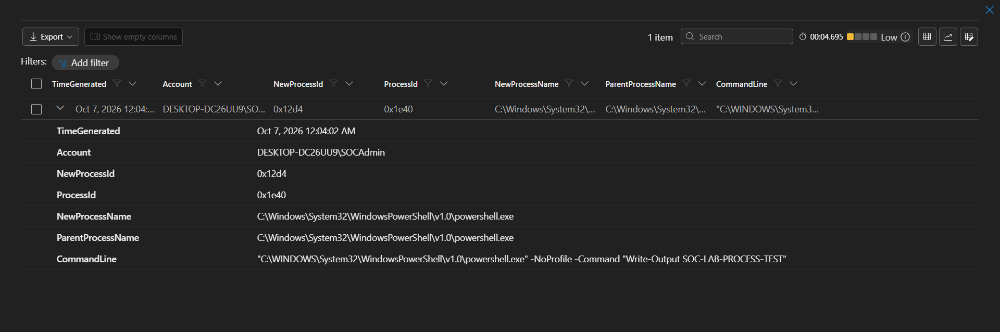
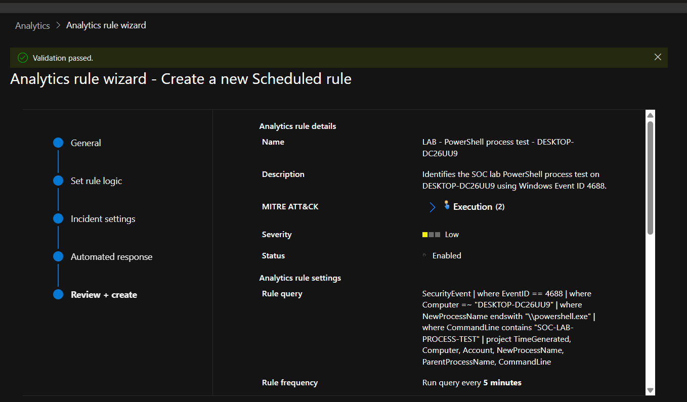
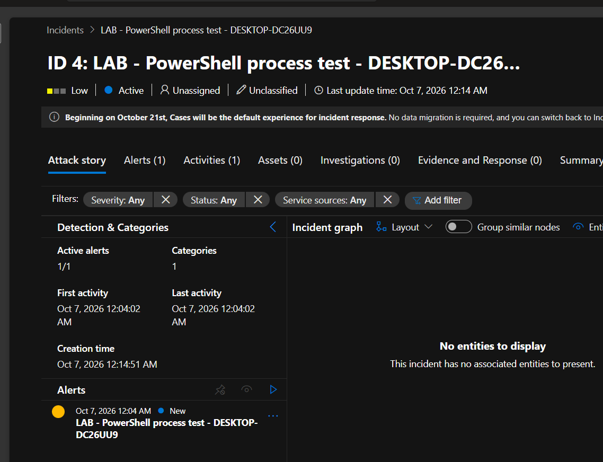
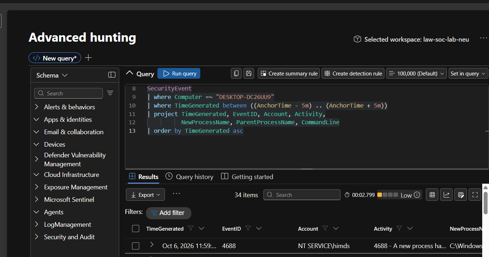

# SOC Investigation 01 — PowerShell Process Detection in Microsoft Sentinel

**Case type:** Authorized detection-and-investigation simulation  
**Date of event:** 7 October 2026 (timestamps as displayed in the historical portal records)  
**Lab endpoint:** `DESKTOP-DC26UU9` / `SOC-WIN11-ENDPOINT`  
**Account:** `DESKTOP-DC26UU9\SOCAdmin`  
**Primary platform:** Microsoft Sentinel, backed by Windows Security Events in Log Analytics  
**Case reference:** Microsoft Sentinel Incident **4**  
**Severity:** Low  
**Disposition:** Expected activity / authorized security testing (historical case notes)

> **Scope:** This is a home-lab case study, not a real-world intrusion or production incident. The investigation and screenshots are historical. The Azure subscription was later disabled; this report does not assert current cloud access or an active analytics rule.

## Executive summary

I built a scheduled Microsoft Sentinel analytics rule to detect a distinctive PowerShell process-creation event on a Windows 11 lab endpoint. The first controlled attempt exposed a source-logging gap: Windows Process Creation auditing had been disabled, so no Event ID `4688` was generated. After enabling process creation auditing and command-line capture, I ran a harmless, identifiable PowerShell child process. The event was collected through the Azure Monitor Agent (AMA) and Data Collection Rule (DCR) into the Sentinel `SecurityEvent` table. The rule matched the event, generating one Low-severity alert and Sentinel Incident **4**.

I investigated the account, process chain, command line and neighboring events. A ±5-minute timeline contained **34** events; filtering to Event ID `4688` in a narrower window returned **12**, and an account-focused filter isolated **one** relevant PowerShell event. The evidence supported authorized test activity, not a compromise. The recorded analyst decision was informational/expected activity with no incident-driven containment or remediation.

## Environment and detection path

`Windows 11 endpoint → Windows Security Event 4688 → AMA + DCR → Log Analytics / SecurityEvent → Microsoft Sentinel scheduled rule → alert → Incident 4 → KQL investigation`

The relevant VM was `SOC-WIN11-ENDPOINT` (Windows hostname `DESKTOP-DC26UU9`), and the deliberate process ran under the local `SOCAdmin` account. This case uses **Windows Security Events** in the `SecurityEvent` table, **not** a verified Sysmon-to-Sentinel collection path or a Defender for Endpoint alert.

## 1. Source telemetry: diagnose and fix the missing event

An initial PowerShell exercise produced no Event ID `4688`. A source-side check returned **Process Creation: No Auditing**. I enabled successful process creation auditing and the policy to include process command-line arguments. The documented commands were:

```powershell
auditpol /get /subcategory:"Process Creation"
auditpol /set /subcategory:"Process Creation" /success:enable
reg add "HKLM\SOFTWARE\Microsoft\Windows\CurrentVersion\Policies\System\Audit" /v ProcessCreationIncludeCmdLine_Enabled /t REG_DWORD /d 1 /f
```

The audit setting changed to **Success**, and the registry value was verified as `0x1`. The subsequent test generated a local Event ID `4688`, with corresponding records appearing in Sentinel. This was an instrumentation issue at the source, not evidence that Sentinel had missed an event that Windows had generated.

## 2. Controlled test and process evidence

The documented harmless test command, launched from an existing PowerShell session, was:

```powershell
powershell.exe -NoProfile -Command "Write-Output SOC-LAB-PROCESS-TEST"
```

The investigation established the following fields for the matching process event:

| Field | Historical finding |
| --- | --- |
| Computer | `DESKTOP-DC26UU9` |
| Account | `DESKTOP-DC26UU9\SOCAdmin` |
| Event ID | `4688` — process creation |
| Parent image | `powershell.exe` |
| New process image | `powershell.exe` |
| Parent process ID | `0x1e40` |
| New process ID | `0x12d4` |
| Command-line marker | `SOC-LAB-PROCESS-TEST` |
| Event time in portal | 7 October 2026, `00:04:02` |

The parent and child images were both PowerShell because the command intentionally launched another PowerShell process from an existing PowerShell session.



*Evidence 01 — Original archived `Screenshot (347).png`, additionally cropped to remove an unrelated portal account-avatar header. The image directly shows the account, timestamp, executable paths, command line and parent/child PIDs. The Event ID itself is established by the connected `SecurityEvent` record and investigation notes, rather than a visible Event ID column in this crop.*

## 3. Sentinel analytics rule and incident generation

The original scheduled rule was named `LAB - PowerShell process test - DESKTOP-DC26UU9`. The historical notes record a **5-minute schedule**, **10-minute lookback**, **Low** severity, a threshold of more than zero results, incident creation enabled and no automated response playbook. The preserved rule query was:

```kql
SecurityEvent
| where EventID == 4688
| where Computer =~ "DESKTOP-DC26UU9"
| where NewProcessName endswith "\\powershell.exe"
| where CommandLine contains "SOC-LAB-PROCESS-TEST"
| project TimeGenerated, Computer, Account, NewProcessName, ParentProcessName, CommandLine
```



*Evidence 02 — Original `Screenshot (329).png`, cropped. This **Review + create** screen shows the rule query, status, severity, frequency and successful validation. It is a **pre-save** configuration view and does not on its own prove a rule was saved.*

After the controlled test was rerun, the historical case recorded **one alert and Incident 4**. The incident activity was shown at `00:04:02` on 7 October 2026; the incident was created at approximately `00:14:51`.



*Evidence 03 — Original `Screenshot (334).png`, cropped. The portal shows Incident 4, Low severity and one active alert. It also shows **“No entities to display”**: entity mapping had not been configured in the rule. The incident was **Active / Unclassified at the time of this screenshot**, which precedes the later documented disposition.*

## 4. Investigation and event correlation

I anchored the investigation on the `4688` event containing the unique marker and examined nearby records:

| Query stage | Historical result | What changed |
| --- | ---: | --- |
| Initial timeline | **34** | Events in the ±5-minute window around the anchor |
| Process-creation focus | **12** | Event ID `4688` in a ±2-minute window |
| Account focus | **1** | Matching `SOCAdmin` PowerShell process event |



*Evidence 04 — Original `Screenshot (340).png`, cropped. It directly shows the time-bounded query excerpt and **34** results. The editor is scrolled, so the full `AnchorTime` definition is not visible. The 12- and 1-event stages were separately observed in archived `Screenshot (344).png` and `Screenshot (345).png`, and are recorded in Module 11.*

The relevant event showed an existing `powershell.exe` process (`0x1e40`) launching a child `powershell.exe` (`0x12d4`). Searches of the parent process's creation record over 12-hour and 30-day windows returned no match. The likely explanation was that its creation preceded the point at which Process Creation auditing was enabled, but the exact reason for the absence could not be proven.

A nearby successful-logon Event ID `4624` belonged to `NT AUTHORITY\SYSTEM` with Logon Type **5** (service), rather than a linked interactive sign-in by `SOCAdmin`. Timestamp proximity alone was therefore insufficient to establish a relationship with the PowerShell process.

## 5. Assessment, MITRE ATT&CK and response

**Observed behavior:** A local user intentionally executed a known PowerShell test command; source and cloud telemetry recorded the corresponding process creation; the rule generated an alert and incident as designed.

**MITRE ATT&CK:** `T1059.001 — Command and Scripting Interpreter: PowerShell` describes the interpreter execution behavior observed in the lab. This **does not** mean an adversary executed the command.

**Analyst verdict:** Authorized, benign security testing. The recorded investigation found no malicious follow-on behavior within the evidence examined. This is not a detection-logic false positive: the rule matched its intended test condition.

**Response decision:** No endpoint isolation, account disablement, password reset, malware removal or other incident-driven containment/remediation was justified. The case notes record the incident as resolved with an informational/expected-security-testing disposition. The saved-closure result is supported by historical written records; original `Screenshot (338).png` shows the **management dialog before Save** and is therefore **not** included as a screenshot proving successful closure.

**Rule recommendation:** Retain useful detection coverage; tune it if repeated authorized test activity creates excessive alert noise. This was the historical recommendation, not a claim that the rule is active now.

## Limitations and evidence integrity

- This is a historical lab exercise. The Azure subscription was subsequently disabled.
- The parent process creation event could not be retrieved; the likely cause is not independently proven.
- The analytics rule had no entity mapping, so the incident entity graph was empty.
- The full exact KQL syntax of every original investigative timeline query was not preserved. The screenshot shows a query excerpt and a real result count; any reconstructed full query should be labeled as reconstructed.
- The primary screenshots are **content-preserving crops** of the original archive images. Browser address bars containing tenant identifiers were excluded, but the lab hostname and workspace name remain visible. The selected images underwent visual privacy review before public release; retained lab identifiers were approved for disclosure.
- The screenshot of the selected closure settings precedes saving; do not use it as sole proof that the incident state changed.

## Lessons learned

1. Verify event generation **at the Windows source** before blaming SIEM ingestion or detection logic.
2. Correlate account, parent/child process IDs, command line and timeline rather than relying on an Event ID alone.
3. Treat missing telemetry and unrelated nearby events as explicit investigation limitations.
4. Distinguish an alert that correctly detects a harmless authorized test from an actual compromise.
5. Match the response to the evidence; avoid disruptive containment when it is not justified.

## Evidence provenance

Primary selected evidence came from the uploaded `Screenshots(2).zip`, which retained the historical numbered images. The four included image crops correspond to original screenshots **347, 329, 334 and 340**. Supporting, intentionally omitted images include **344** (12 events), **345** (one matching event), and **338** (pre-save proposed closure). The detailed case source is Module 11, supported by ATT&CK mapping in Module 12 and response decisions in Module 13.


## QA verification and publication status

- **Evidence and technical cross-check:** Completed on 24 November 2026 against the relevant Notion modules and the original numbered images in `Screenshots(2).zip`.
- **Screenshot provenance:** Original archive members were retained unchanged. Selected images are derived, documented crops/redactions; see `EVIDENCE_MANIFEST.md` for SHA-256 fingerprints of originals and packaged copies.
- **Privacy inspection:** No visible real email address, browser URL containing a tenant GUID, credential, token, or exposed IP/MAC address was identified in the packaged images. Lab hostname, local account and selected workspace labels are intentionally retained with author approval for technical context.
- **Remaining release steps:** This report and its four curated images are published in the public GitHub repository. The original screenshot archive is not included.
