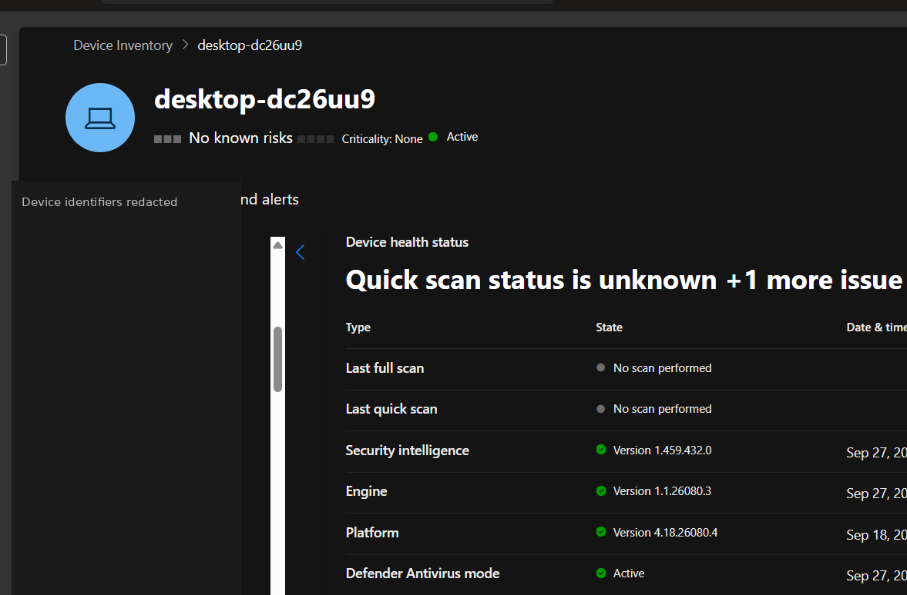
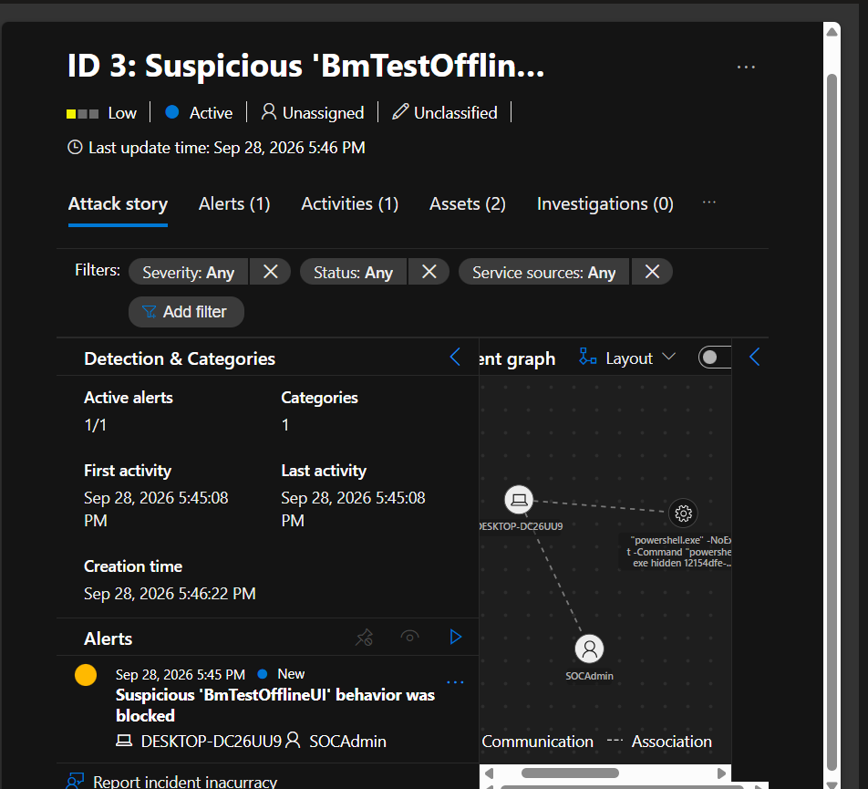
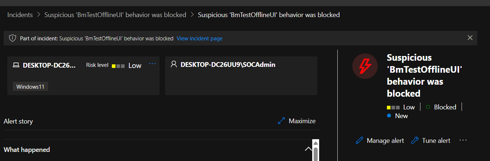
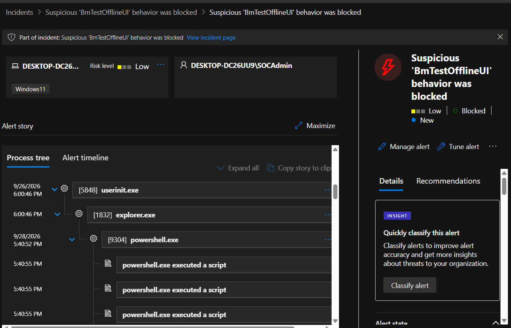
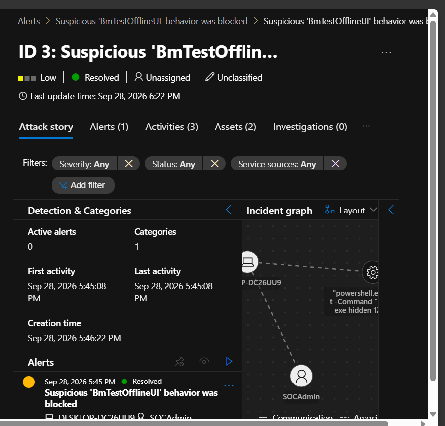
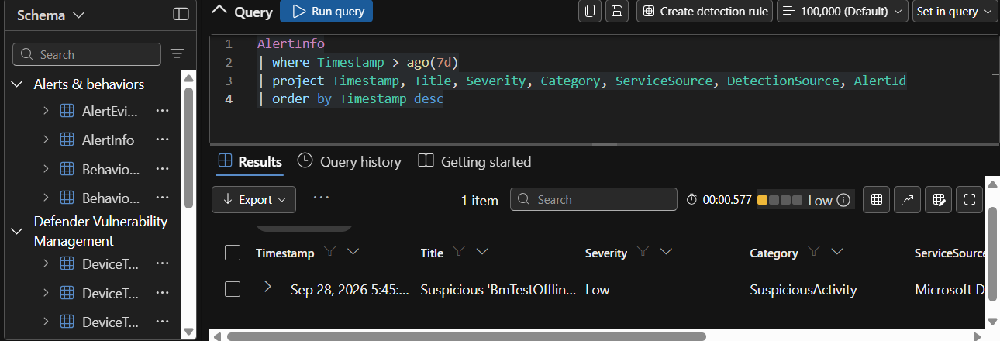

# SOC Investigation 02 — Controlled Behavior-Monitoring Detection in Microsoft Defender XDR

**Case type:** Authorized Defender for Endpoint detection-and-investigation simulation  
**Underlying activity:** 28 September 2026 (timestamps as displayed in historical Defender portal)  
**Environment:** Windows 11 lab VM (`SOC-WIN11-ENDPOINT`, hostname `DESKTOP-DC26UU9`)  
**Local account:** `DESKTOP-DC26UU9\SOCAdmin`  
**Security platform:** Microsoft Defender for Endpoint / Microsoft Defender XDR  
**Case reference:** Defender XDR Incident **3**  
**Severity:** Low  
**Observed protection result:** Blocked  
**Final incident status:** Resolved; **incident classification:** Unclassified  
**Analyst's recorded alert classification:** Informational, expected activity

> **Scope and provenance:** This is a historical SOC home-lab investigation, not an actual compromise or production response. It is based on the original screenshots preserved in `Screenshots(2).zip` and the detailed historical Module 10 notes (Steps 10.2–10.6). The lab previously used a Defender for Business trial; this report does not claim current licensing, live portal access or ongoing monitoring. Screenshot clock times are presented as displayed, without assuming a timezone.

## Executive summary

I onboarded a Windows 11 virtual machine to Microsoft Defender for Endpoint and verified that it appeared as Active in Defender Device Inventory with Defender Antivirus in Active mode. I then executed a Microsoft-supported, harmless Behavior Monitoring test from PowerShell to validate the detection pipeline.

The test command produced a local PowerShell `CommandNotFoundException` for the `hidden` token. Despite this, Defender recorded **“Suspicious 'BmTestOfflineUI' behavior was blocked”** as a **Low-severity, Blocked** alert, which was grouped into **Defender XDR Incident 3**. I investigated the endpoint and local account, reviewed the process chain `userinit.exe → explorer.exe → powershell.exe`, and established that the behavior matched the authorized test rather than an unplanned intrusion.

The historical notes record that the **alert** was classified **Informational, expected activity** and resolved. The original screenshots independently show the proposed alert classification in a **pre-save** management dialog, the alert later displayed as **Resolved**, and the **incident** displayed as **Resolved with zero active alerts**. Critically, the parent incident's separate classification remained **Unclassified**. This is an important distinction between an alert's analyst label, its saved resolution status, and an incident's own classification.

## Environment and investigative scope

- **VM:** `SOC-WIN11-ENDPOINT`, Windows hostname `DESKTOP-DC26UU9`.
- **Identity:** Local Windows administrative account `SOCAdmin`; limited cloud-user profile information was expected because this was not an Entra cloud user.
- **Endpoint protection:** Microsoft Defender Antivirus with real-time protection and Behavior Monitoring enabled during the controlled test; Microsoft Defender for Endpoint used for cloud endpoint visibility and alerting.
- **Investigation interface:** Microsoft Defender XDR incident, alert details, process tree, and a later Advanced Hunting query.

**Detection path:** `Controlled PowerShell behavior → local Defender protection/sensor → Microsoft Defender cloud alert → Defender XDR Incident 3 → analyst triage / process review → alert disposition → incident resolved`.

This is an **endpoint detection case**, not a Microsoft Sentinel `SecurityEvent` / AMA / DCR analytics-rule case. The Sentinel PowerShell Event `4688` investigation is a *different* report and Incident **4**.

## 1. Endpoint onboarding and pre-test state

Module 10 documents onboarding the existing Windows 11 VM through the Defender portal's **Local Script** approach. The onboarding script was run from an elevated Command Prompt and returned `Successfully onboarded machine to Microsoft Defender for Endpoint`. This local success message was **not** treated as sufficient proof of cloud health; the Device Inventory was checked separately.

In the historical Defender portal, the endpoint `desktop-dc26uu9` appeared **Active** with **No known risks**, and Defender Antivirus mode **Active**. Its security-intelligence, engine and platform version fields were populated. The health panel simultaneously reported that no full scan or quick scan had yet been recorded. That is a scan-history limitation, not a finding that onboarding failed.



*Evidence 01 — Cropped/redacted original `Screenshot (119).png`: cloud-side endpoint visibility, Active protection status and the still-missing scan history. Network identifiers and the browser URL were excluded or masked; the original source image was not modified.*

Before the controlled detection test, the historical endpoint check returned:

```powershell
Get-MpComputerStatus | Select RealTimeProtectionEnabled, BehaviorMonitorEnabled
```

```text
RealTimeProtectionEnabled BehaviorMonitorEnabled
------------------------- ----------------------
                     True                   True
```

The command output comes from Module 10's historical record; it is not displayed in Evidence 01.

## 2. Controlled behavior-monitoring test

The Microsoft Defender Behavior Monitoring demonstration was run from elevated Windows PowerShell. The preserved historical command is:

```powershell
powershell.exe -NoExit -Command "powershell.exe hidden 12154dfe-61a5-4357-ba5a-eefcc45c34c4"
```

The PowerShell console then reported that `hidden` could not be recognized as a command:

```text
hidden : The term 'hidden' is not recognized as the name of a cmdlet,
function, script file, or operable program.
FullyQualifiedErrorId : CommandNotFoundException
```

**Interpretation:** The local shell did **not** successfully execute a command named `hidden`. The test still generated Defender's documented detection, so the console error and the security detection outcome must be evaluated separately. This controlled activity did not install malware or target an external system.

## 3. Defender detection and initial Incident 3

Defender generated one Low-severity incident containing one alert:

| Historical field | Observed value |
| --- | --- |
| Incident | **3** |
| Alert title | `Suspicious 'BmTestOfflineUI' behavior was blocked` |
| Severity | Low |
| Initial incident status | Active |
| Initial incident classification | Unclassified |
| Initial active alerts | **1/1** |
| First and last incident activity | 28 September 2026, **5:45:08 PM** |
| Incident creation time | 28 September 2026, **5:46:22 PM** |
| Device | `DESKTOP-DC26UU9` |
| Account | `DESKTOP-DC26UU9\SOCAdmin` |



*Evidence 02 — Original `Screenshot (125).png`, cropped: Incident 3, Low severity, one active alert, affected device and user, and the initial Active/Unclassified state. The screenshot does not imply that the case was already resolved.*

Opening the individual alert provided an important distinction between two different status indicators: **Blocked** described Defender's protection outcome, whereas **New** described the alert's state in the analyst workflow. An alert can be technically blocked by Defender while still requiring investigation and closure in the portal.



*Evidence 03 — Original `Screenshot (126).png`, cropped: separate `Blocked` and `New` indicators, Low severity and the associated local user. The hostname in one device card is truncated; the account field and Incident 3 screenshot provide the fuller device context.*

The historical investigation notes also describe process termination and successful remediation by Defender. Those additional outcomes are preserved as **written historical observations**, rather than independent conclusions from Evidence 03.

## 4. Endpoint investigation: process ancestry and user context

The Defender XDR alert's **Process tree** showed:

```text
userinit.exe [PID 5848]
    └── explorer.exe [PID 1832]
          └── powershell.exe [PID 9304]
                ├── powershell.exe executed a script
                ├── powershell.exe executed a script
                └── powershell.exe executed a script
```

The screenshot shows `userinit.exe` and `explorer.exe` starting on **26 September 2026 at 6:00:46 PM**, while `powershell.exe` started on **28 September 2026 at 5:40:52 PM**, followed by script-execution entries at approximately **5:40:55 PM**. These are **not** a claim that the ancestor processes started at the time of the September 28 incident. The earlier processes show the existing interactive Windows session from which PowerShell was launched.



*Evidence 04 — Original `Screenshot (127).png`, cropped: user-session ancestry, process IDs, script-execution entries and the local account. The full script bodies are not visible, and the image does not independently identify which script entry generated the alert.*

**Analyst reasoning:** The host, local user, PowerShell process and known test context were consistent with the controlled Behavior Monitoring exercise. The process tree established relevant execution context but was **not sufficient on its own** to infer malicious intent. Defender had partial cloud-user information because `SOCAdmin` was a local account.

## 5. Analyst classification and incident resolution

The original record preserves a sequence of **distinct** alert/incident UI states:

| Evidence | Stage | What it establishes |
| --- | --- | --- |
| `Screenshot (128).png` | Alert **Manage alert** dialog | `Resolved` and `Informational, expected activity` **selected**, but **Save still visible** — proposed disposition, not independently confirmed persisted classification |
| `Screenshot (130).png` | Defender Alerts list | The same `BmTestOfflineUI` alert displayed as **Resolved** — saved alert status verified |
| `Screenshot (132).png` | Defender Incident 3 | Parent incident displayed **Resolved** with **0 active alerts**, while its separate **incident classification remained Unclassified** |

The historical Module 10 notes record the analyst having applied **Informational, expected activity** as the *alert-level* classification and then resolving the alert. However, the screenshots do **not** independently show that this classification field persisted after Save; the pre-save dialog is evidence of the intended classification. The saved **Resolved** status, by contrast, is directly corroborated by the alert list and final incident view.



*Evidence 05 — Original `Screenshot (132).png`, cropped: Incident 3, `Resolved`, `0` active alerts, one total alert, and incident-level `Unclassified`. Do **not** relabel the parent incident as classified “Informational.”*

**Disposition:** This was an authorized, harmless demonstration recognized by Defender's alerting logic. No real compromise was identified within the investigated scope, and there was **no need for incident-driven device isolation, account disabling or malware-removal intervention**. The historical analyst verdict was expected activity. The lab's *other* remote isolation/release, application-restriction, quick-scan and Live Response tests were separate **response-capability exercises**; they were not actions taken to contain Incident 3.

## 6. Optional technical appendix: Advanced Hunting

In a separate Defender Advanced Hunting capability exercise, the `DeviceInfo` query and software-inventory query encountered availability/backend errors in this lab. The analyst then queried `AlertInfo`, which successfully returned one Low-severity `SuspiciousActivity` alert related to the September 28 test. The original historical query was:

```kql
AlertInfo
| where Timestamp > ago(7d)
| project Timestamp, Title, Severity, Category, ServiceSource, DetectionSource, AlertId
| order by Timestamp desc
```



*Optional Evidence 06 — Original `Screenshot (170).png`, cropped to remove unrelated cursor/header UI: exact `AlertInfo` KQL and one returned result, with execution duration `00:00.577`. Some result text is truncated. The relative seven-day time window was evaluated at the historical execution date; rerunning the query today would not reproduce that record without appropriate retained data and a changed filter.*

The query is also retained in [`queries/alertinfo-historical.kql`](queries/alertinfo-historical.kql). Its `ago(7d)` clause is preserved as original **historical syntax** for provenance, not as a promise of current reproducibility.

## 7. Lessons learned and limitations

1. **Validate source state and cloud visibility separately.** Local onboarding success and Active cloud inventory are different evidence layers.
2. **Separate execution errors from security detections.** PowerShell reported `CommandNotFoundException`, but Defender still blocked the controlled test behavior and generated an alert.
3. **Investigate user and process context.** The process tree helped link the alert to an existing session and an identified local account, rather than automatically treating PowerShell as malicious.
4. **Distinguish protection, alert status and incident status.** `Blocked` ≠ `New` ≠ `Resolved`; alert classification and incident classification are separate fields.
5. **Preserve evidence limitations.** The pre-save alert classification does not independently prove persistence; process tree entries predate the alert; cloud screenshots do not prove present-day service availability.
6. **Keep response-capability tests distinct from incident actions.** The later Defender remote controls were practice exercises, not containment of a confirmed attack.

**MITRE ATT&CK note:** PowerShell execution can be described as interpreter activity relevant to the `T1059.001` technique concept, but these screenshots do **not** establish adversary tradecraft or a malicious technique invocation. No attack attribution is asserted for this authorized test.

## Evidence integrity and publication status

- The five primary images and optional Advanced Hunting image are **content-preserving crops** of original numbered PNGs in `Screenshots(2).zip`. Browser URLs containing identifier strings were excluded; an IP/MAC panel in Evidence 01 was masked. The original archive was not edited.
- The cropped images still display the lab hostname, local account and some portal context. Review for remaining personal/tenant identifiers, date labels and legibility before any public release.
- The original raw `Screenshots(2).zip`, Defender investigation package, tenant credentials, local host diagnostics and unrelated screenshots are **not** included in this package.
- There is no independently verified live cloud availability or license state at this drafting date. The historical Defender trial and later disabled Azure subscription do not imply currently active security services.
- Avoid claiming that screenshots of a UI **before Save** prove the backend status changed. The included post-save incident image is the stronger closure proof.
- This case and the separate **Microsoft Sentinel Incident 4** case cover different detection platforms and must not be conflated.

*Source record:* SOC Lab Notion, Module 10 Steps 10.2–10.6; Module 14 Steps 14.2 and 14.4. See `EVIDENCE_MANIFEST.md` for screenshot provenance. This portfolio report is a draft, **not yet published**.


## QA verification and public-release boundary

- **Evidence and technical cross-check:** Completed on 24 November 2026 against the relevant Notion modules and the original numbered images in `Screenshots(2).zip`.
- **Screenshot provenance:** Original archive members were retained unchanged. Selected images are derived, documented crops/redactions; see `EVIDENCE_MANIFEST.md` for SHA-256 fingerprints of originals and packaged copies.
- **Privacy inspection:** No visible real email address, browser URL containing a tenant GUID, credential, token, or exposed IP/MAC address was identified in the packaged images. Lab hostname, local account and selected workspace labels are intentionally retained for technical context; confirm they may be published before uploading.
- **Remaining release steps:** Confirm the public identity convention for lab names, perform final human review at display resolution, and integrate both reports into the top-level GitHub repository. This ZIP has **not** been published.
